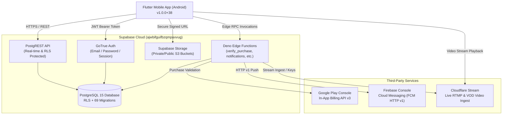

# Modern Classes Patna — Final Project Handoff & Technical Manual

**Application Identifier:** `com.modernclasses.patna.modern_classes_patna`  
**Latest Production Release:** `1.0.0+38` (Version Code `38`, Version Name `1.0.0`)  
**Delivery Date:** November 19, 2026  
**Document Classification:** Final Delivery / Client Handover  
**Repository:** [https://github.com/modernclasses/modernclassespatna](https://github.com/modernclasses/modernclassespatna) (Branch: `master`)  

---

## 1. Executive Summary & Deliverables Inventory

This document serves as the complete, authoritative technical handover manual for the Modern Classes Patna educational mobile ecosystem. All requested deliverables, architectural modules, database schemas, and release artifacts have been completed, tested, and pushed to version control.

### Delivered Artifacts Summary

| Artifact | Location / Reference | Description |
| :--- | :--- | :--- |
| **Android Release App Bundle (AAB)** | [`app-release-v38.aab`](file:///d:/coaching%20app%20demo/app-release-v38.aab) | Production-ready signed bundle for Google Play Console upload (`1.0.0+38`, 70.2 MB). |
| **Release Keystore** | [`android/app/upload-keystore.jks`](file:///d:/coaching%20app%20demo/android/app/upload-keystore.jks) | Google Play app signing certificate (required for all future updates). |
| **Keystore Configuration** | [`android/key.properties`](file:///d:/coaching%20app%20demo/android/key.properties) | Password, alias, and key configuration for automated Gradle builds. |
| **Source Code Repository** | `https://github.com/modernclasses/modernclassespatna` | Complete Flutter 3.29+ mobile application source code (Git branch: `master`). |
| **Database Migrations** | [`supabase/migrations/`](file:///d:/coaching%20app%20demo/supabase/migrations/) | 69 sequential PostgreSQL migration scripts (`001` through `069`). |
| **Serverless Edge Functions** | [`supabase/functions/`](file:///d:/coaching%20app%20demo/supabase/functions/) | 7 TypeScript / Deno functions for billing, push notifications, and Cloudflare streaming. |
| **Automated Test Suite** | [`test/`](file:///d:/coaching%20app%20demo/test/) | 51 passing unit, widget, and architectural contract tests. |

---

## 2. High-Level Architecture & Data Flow



---

## 3. Account Ownership & Decoupling Checklist

To ensure a clean, permanent handover, the client must hold primary ownership of all services, and any developer personal accounts must be removed.

### 3.1 Service Inventory & Ownership Status

| Service | Identifier / Account | Action Required by Client | Status |
| :--- | :--- | :--- | :---: |
| **GitHub Repository** | `modernclasses/modernclassespatna` | Client organization holds repository. Ensure developer is removed from collaborators/teams. | Transfer Ready |
| **Supabase Cloud** | Project: `ajwbifguifbzqmpaxvug` | Add client's email as `Owner` in Project Settings -> Team. Remove developer. | Action Required |
| **Google Play Console** | `com.modernclasses.patna.modern_classes_patna` | Invite client's Google Account as Account Owner / Admin in Users & Permissions. | Action Required |
| **Firebase Console** | Project: `modern-classes-377d0` | Add client's email as `Owner` in Project Settings -> Users and permissions. | Action Required |
| **Cloudflare Account** | Stream Account ID | Transfer ownership or update billing details in Cloudflare dashboard. | Action Required |
| **Google Cloud Platform** | Project: `118106266506` | Project holds Service Account for Play Billing API. Add client as IAM Owner. | Action Required |

> [!CAUTION]
> **Developer Decoupling Protocol:** Once the client verifies administrative access to the services above, the client must remove the developer's personal email, SSH keys, and collaborator access from GitHub, Supabase, Firebase, and Google Play Console. The developer will retain zero access, rights, or liability for these services.

---

## 4. Key Management & Release Signing

### 4.1 Production Keystore Details

The Android application is signed using an RSA 2048-bit release keystore. **Keep this file backed up in multiple secure locations.** If this keystore is lost, Google Play will **never** accept updates for this application.

- **Keystore File Location:** [`android/app/upload-keystore.jks`](file:///d:/coaching%20app%20demo/android/app/upload-keystore.jks)
- **Configuration File:** [`android/key.properties`](file:///d:/coaching%20app%20demo/android/key.properties)
- **Alias:** Stored inside `android/key.properties` under `keyAlias`
- **Keystore Passwords:** Stored inside `android/key.properties` under `storePassword` and `keyPassword`

### 4.2 Building Future Mobile Releases

When building an updated Android App Bundle for Google Play:
1. Open [`pubspec.yaml`](file:///d:/coaching%20app%20demo/pubspec.yaml) and increment the version (e.g. `version: 1.0.1+39`).
2. Run the release bundle command in PowerShell:
   ```powershell
   flutter build appbundle --release
   ```
3. Locate the signed output at `build/app/outputs/bundle/release/app-release.aab`.
4. Upload the generated `.aab` file to the [Google Play Console](https://play.google.com/console).

---

## 5. Database Architecture & Operations

### 5.1 Project Infrastructure
- **Provider:** Supabase (PostgreSQL 15)
- **Instance URL:** `https://ajwbifguifbzqmpaxvug.supabase.co`
- **Connection Mode:** Supavisor Connection Pooler (Port 6543 / 5432)

### 5.2 Critical Migration Milestones
- **Migrations 001–063:** Core data models (profiles, courses, batches, lessons, test papers, submissions, doubts, transactions).
- **Migration 064:** Materialized view `vw_courses_with_stats` and live class recording sync triggers.
- **Migration 065:** Complete security hardening (prevented PII leakage, restricted test answer sheets, hardened search paths).
- **Migration 066:** Clean data reset prior to launch (purged mock test records while preserving root admin).
- **Migration 067:** Fixed recursion and PostgreSQL stack depth limit (`54001`) on profile lookup.
- **Migration 068:** 100% Scholarship / Free coupon architecture (`FREE100`) and remote coupon table validation.
- **Migration 069:** Zero-amount transaction audit logging and manual collection ledger separation for free coupon redemptions.

### 5.3 Storage Buckets & Policies

| Bucket Name | Visibility | Allowed MIME Types | Max Size | Access Scope |
| :--- | :---: | :--- | :---: | :--- |
| `lecture-videos` | **Private** | `video/*` (`mp4`, `webm`, `mkv`) | 50 MB | Enrolled students & assigned faculty via signed URLs. |
| `study-materials` | **Private** | `application/pdf`, `msword` | 50 MB | Batch-enrolled students and faculty. |
| `doubt-attachments` | **Private** | `image/*`, `application/pdf` | 50 MB | Doubt creator, assigned batch faculty, and admins. |
| `course-thumbnails` | **Public** | `image/*` | 50 MB | Public read for storefront course cards. |
| `lecture-thumbnails`| **Public** | `image/*` | 50 MB | Public read for video preview cards. |

---

## 6. Serverless Edge Functions Directory

The application relies on 7 deployed Supabase Edge Functions located in [`supabase/functions/`](file:///d:/coaching%20app%20demo/supabase/functions/):

1. **`verify_purchase`**: Validates Google Play In-App Purchases against Google Play Developer API v3. Enforces that all mock purchase tokens are rejected in production.
2. **`send_push_notification`**: Dispatches push notifications to Android devices via Firebase Cloud Messaging (FCM HTTP v1). Prunes obsolete or dead tokens automatically.
3. **`cloudflare_stream_manager`**: Creates live stream RTMP inputs and fetches playback URLs via Cloudflare Stream REST API.
4. **`admin_create_teacher`**: Server-side administrative creation of faculty profiles.
5. **`student_update_display_name`**: Authoritative one-time student profile name updater with profanity filters.
6. **`reset-password`**: Password recovery email dispatch.
7. **`retry_acknowledgements`**: Background retry worker for unacknowledged Play Store purchases.

---

## 7. Operational Troubleshooting & Runbook

### Scenario A: Google Play Purchase Verification Fails
- **Symptom:** Student completes in-app payment, but batch does not unlock immediately.
- **Resolution:**
  1. Open Supabase Dashboard -> **Logs** -> **Edge Functions** -> Select `verify_purchase`.
  2. If the log reports `403 Google API Permission Denied`, check that the Google Cloud Service Account in project `118106266506` has "View Financial Data" and "Manage Orders" permissions in Google Play Console.
  3. **Immediate Relief:** The Admin can manually enroll the student into the batch via the Admin Dashboard or by inserting a record into `public.enrollments`.

### Scenario B: Live Stream Does Not Display
- **Symptom:** Live stream player shows a loading spinner or connection error.
- **Resolution:**
  1. Verify the teacher's streaming software (e.g. OBS Studio) is broadcasting to the correct RTMPS URL and stream key.
  2. Verify that `CLOUDFLARE_API_TOKEN` and `CLOUDFLARE_ACCOUNT_ID` in Supabase Edge Function secrets have active video streaming permissions.

### Scenario C: Push Notifications Not Delivered
- **Symptom:** Students do not receive batch or live class alerts.
- **Resolution:**
  1. Verify device notification permissions on the student's Android device.
  2. Check `public.user_device_tokens` table in Supabase to confirm the student has a registered token.
  3. Ensure `FCM_SERVICE_ACCOUNT_KEY` secret in Supabase Edge Functions is valid.

---

## 8. Warranty & Support Disclaimer

1. **Delivery Acceptance:** Delivery of the source code, compiled release bundle, and documentation constitutes full and final completion of the development agreement.
2. **As-Is Provision:** All software, configurations, scripts, and documentation are delivered "as-is", having passed all 51 automated regression and contract tests.
3. **Third-Party Services:** The ongoing availability, rate limits, billing, and uptime of external services (Google Play, Supabase, Firebase, Cloudflare) are governed solely by their respective providers and are the sole responsibility of the client.
4. **Post-Handoff Support:** Any future feature requests, third-party API deprecation updates, OS platform migrations, or maintenance must be contracted under a separate, newly negotiated written agreement.
