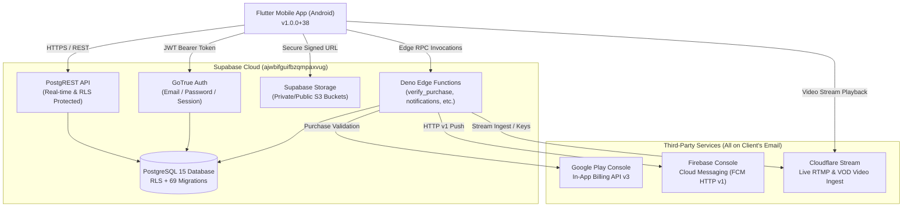

# Modern Classes Patna — Final Project Handoff & Technical Manual

**Application Identifier:** `com.modernclasses.patna.modern_classes_patna`  
**Latest Production Release:** `1.0.0+38` (Version Code `38`, Version Name `1.0.0`)  
**Delivery Date:** November 19, 2026  
**Document Classification:** Final Delivery / Client Handover  
**Repository:** [https://github.com/modernclasses/modernclassespatna](https://github.com/modernclasses/modernclassespatna) (Branch: `master`)  

---

## 1. Executive Summary & Account Provisioning Context

All cloud infrastructure, repositories, and developer consoles for **Modern Classes Patna** were set up directly using the **client's email address**. Consequently:
- **Full ownership already resides with the client.** There is no complex account migration or ownership transfer required between different emails.
- **What is being transferred:** The offline build assets, cryptographic code-signing keys, complete source code repository, and the master service inventory.
- **Final Security Step:** The client simply needs to update passwords, confirm billing cards, and terminate any active developer sessions.

### Delivered Artifacts Summary

| Artifact | Location / Reference | Description |
| :--- | :--- | :--- |
| **Android Release App Bundle (AAB)** | [`app-release-v38.aab`](file:///d:/coaching%20app%20demo/app-release-v38.aab) | Production-ready signed bundle for Google Play Console upload (`1.0.0+38`, 70.2 MB). |
| **Release Keystore** | [`android/app/upload-keystore.jks`](file:///d:/coaching%20app%20demo/android/app/upload-keystore.jks) | Google Play app signing certificate (required for all future updates). |
| **Keystore Configuration** | [`android/key.properties`](file:///d:/coaching%20app%20demo/android/key.properties) | Password, alias, and key configuration for automated Gradle builds. |
| **Source Code Repository** | `https://github.com/modernclasses/modernclassespatna` | Complete Flutter 3.29+ mobile application source code (Git branch: `master`). |
| **Database Migrations** | [`supabase/migrations/`](file:///d:/coaching%20app%20demo/supabase/migrations/) | 69 sequential PostgreSQL migration scripts (`001` through `069`). |
| **Serverless Edge Functions** | [`supabase/functions/`](file:///d:/coaching%20app%20demo/supabase/functions/) | 7 TypeScript / Deno functions for billing, push notifications, and Cloudflare streaming. |
| **Automated Test Suite** | [`test/`](file:///d:/coaching%20app%20demo/test/) | 51 passing unit, widget, and architectural contract tests. |

---

## 2. High-Level Architecture & Data Flow



---

## 3. Master Services Inventory & Security Handover

Since all accounts were provisioned under the client's email, the client already has root access. The client must perform the following security steps to take 100% exclusive control:

### 3.1 Service Inventory & Credentials Guide

| # | Platform / Service | Identifier / Resource | Registered Email | Client Action Required |
| :-: | :--- | :--- | :--- | :--- |
| 1 | **Google Account / Gmail** | Root Google Account | Client's Email | Change Google Account password; select **"Sign out of all other sessions"**; ensure 2FA is set to client's phone. |
| 2 | **Google Play Console** | Package: `com.modernclasses.patna.modern_classes_patna` | Client's Google Account | Log in to [Play Console](https://play.google.com/console), verify account status, and upload `app-release-v38.aab`. |
| 3 | **Google Cloud Platform (GCP)** | Project: `118106266506` | Client's Google Account | Used for Google Play Developer API service account credentials. Verify billing method. |
| 4 | **Firebase Console** | Project: `modern-classes-377d0` | Client's Google Account | Used for Firebase Cloud Messaging (push notifications). Confirm project access. |
| 5 | **Supabase Cloud** | Project: `ajwbifguifbzqmpaxvug` | Client's Email | Log in to [Supabase](https://supabase.com/dashboard), change password, verify credit card under Organization Billing. |
| 6 | **GitHub** | `modernclasses/modernclassespatna` | Client's Email (`modernclasses`) | Log in to GitHub, change password, check Settings -> SSH & GPG Keys (delete any old developer keys). |
| 7 | **Cloudflare** | Cloudflare Stream | Client's Email | Verify active payment method for video streaming bandwidth. |

> [!IMPORTANT]
> **Client Action Item — Session Revocation:**  
> Once the client logs into the accounts above, they should update their passwords and choose **"Sign out of all other devices/sessions"**. This guarantees that no previous developer machine retains session cookies or cached tokens.

---

## 4. Local Files Delivery (What Needs to be Sent/Backed Up)

The following files exist on the local project machine and must be preserved by the client:

### 4.1 Production Android App Bundle (`app-release-v38.aab`)
- **File:** [`app-release-v38.aab`](file:///d:/coaching%20app%20demo/app-release-v38.aab) (Size: 70.2 MB)
- **Action:** Ready to be uploaded directly into the Google Play Console under **Release -> Production (or Closed Testing)**.

### 4.2 Cryptographic Signing Keys (CRITICAL)
- **Keystore File:** [`android/app/upload-keystore.jks`](file:///d:/coaching%20app%20demo/android/app/upload-keystore.jks)
- **Configuration File:** [`android/key.properties`](file:///d:/coaching%20app%20demo/android/key.properties)
- **Why this matters:** Google Play permanently binds the application to this keystore certificate. **If this file is lost, the client will never be able to update their app on Google Play.**
- **Action:** The client must download `upload-keystore.jks` and `key.properties` and save them in multiple secure offline locations (e.g. secure USB drive, encrypted cloud storage).

---

## 5. Building Future Releases (Developer Guide for Client's Next Team)

If the client or their future development team needs to build a new version:
1. Clone the repository:
   ```bash
   git clone https://github.com/modernclasses/modernclassespatna.git
   ```
2. Ensure Flutter 3.29+ and Android SDK 34+ are installed.
3. Verify `android/app/upload-keystore.jks` and `android/key.properties` are in place.
4. Increment version number in [`pubspec.yaml`](file:///d:/coaching%20app%20demo/pubspec.yaml) (e.g. `version: 1.0.1+39`).
5. Run the release build command:
   ```powershell
   flutter build appbundle --release
   ```
6. The compiled bundle will be output to: `build/app/outputs/bundle/release/app-release.aab`.

---

## 6. Database Architecture & Operations

### 6.1 Database Specifications
- **Provider:** Supabase (PostgreSQL 15)
- **Instance URL:** `https://ajwbifguifbzqmpaxvug.supabase.co`
- **Connection Mode:** Supavisor Connection Pooler (Port 6543 / 5432)

### 6.2 Migration Ledger (69 Migrations)
- **Migrations 001–063:** Core models (profiles, courses, batches, lessons, test papers, submissions, doubts, transactions).
- **Migration 064:** Materialized view `vw_courses_with_stats` and live class recording sync triggers.
- **Migration 065:** Complete security hardening (prevented PII leakage, restricted test answer sheets, hardened search paths).
- **Migration 066:** Clean data reset prior to launch (purged mock test records while preserving root admin).
- **Migration 067:** Fixed recursion and PostgreSQL stack depth limit (`54001`) on profile lookup.
- **Migration 068:** 100% Scholarship / Free coupon architecture (`FREE100`) and remote coupon table validation.
- **Migration 069:** Zero-amount transaction audit logging and manual collection ledger separation for free coupon redemptions.

### 6.3 Storage Buckets

| Bucket Name | Visibility | Allowed MIME Types | Max Size | Access Scope |
| :--- | :---: | :--- | :---: | :--- |
| `lecture-videos` | **Private** | `video/*` (`mp4`, `webm`, `mkv`) | 50 MB | Enrolled students & assigned faculty via signed URLs. |
| `study-materials` | **Private** | `application/pdf`, `msword` | 50 MB | Batch-enrolled students and faculty. |
| `doubt-attachments` | **Private** | `image/*`, `application/pdf` | 50 MB | Doubt creator, assigned batch faculty, and admins. |
| `course-thumbnails` | **Public** | `image/*` | 50 MB | Public read for storefront course cards. |
| `lecture-thumbnails`| **Public** | `image/*` | 50 MB | Public read for video preview cards. |

---

## 7. Serverless Edge Functions Directory

The application relies on 7 deployed Supabase Edge Functions located in [`supabase/functions/`](file:///d:/coaching%20app%20demo/supabase/functions/):

1. **`verify_purchase`**: Validates Google Play In-App Purchases against Google Play Developer API v3. Enforces that all mock purchase tokens are rejected in production.
2. **`send_push_notification`**: Dispatches push notifications to Android devices via Firebase Cloud Messaging (FCM HTTP v1). Prunes obsolete or dead tokens automatically.
3. **`cloudflare_stream_manager`**: Creates live stream RTMP inputs and fetches playback URLs via Cloudflare Stream REST API.
4. **`admin_create_teacher`**: Server-side administrative creation of faculty profiles.
5. **`student_update_display_name`**: Authoritative one-time student profile name updater with profanity filters.
6. **`reset-password`**: Password recovery email dispatch.
7. **`retry_acknowledgements`**: Background retry worker for unacknowledged Play Store purchases.

---

## 8. Warranty & Support Disclaimer

1. **Delivery Acceptance:** Delivery of the source code, compiled release bundle, and documentation constitutes full and final completion of the development engagement.
2. **As-Is Provision:** All software, configurations, scripts, and documentation are delivered "as-is", having passed all 51 automated regression and contract tests.
3. **Third-Party Services:** The ongoing availability, rate limits, billing, and uptime of external services (Google Play, Supabase, Firebase, Cloudflare) are governed solely by their respective providers and are the sole responsibility of the client.
4. **Post-Handoff Support:** Any future feature requests, third-party API deprecation updates, OS platform migrations, or maintenance must be contracted under a separate, newly negotiated written agreement.
